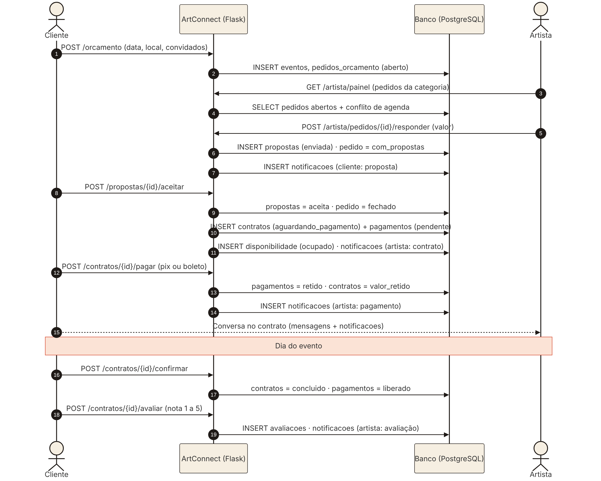

# Diagrama de sequência: contratação e pagamento

O fonte do diagrama está em `diagrama-sequencia-contratacao.mmd` (Mermaid). Para gerar a imagem de novo: `mmdc -i diagrama-sequencia-contratacao.mmd -o diagrama-sequencia-contratacao.png`.

## O que o diagrama mostra

O fluxograma de telas (Sprint 2) mostra **para onde o usuário navega**, e o diagrama de casos de uso (Sprint 6) mostra **o que cada ator pode fazer**. Este diagrama mostra outra coisa: **em que ordem as mensagens passam entre cliente, sistema, banco e artista** durante uma contratação, e qual tabela muda em cada passo.

## Participantes

| Participante | Papel no fluxo |
|---|---|
| Cliente | Pede orçamento, aceita proposta, paga, confirma o evento e avalia |
| ArtConnect (Flask) | Recebe as requisições (rotas do `app.py`) e aplica as regras |
| Banco (PostgreSQL) | Guarda o estado de cada etapa |
| Artista | Vê os pedidos da categoria e envia a proposta |

## Passo a passo e estado do banco

| Passos | Etapa | Status depois da etapa |
|---|---|---|
| 1–2 | Pedido de orçamento | pedido `aberto` |
| 3–7 | Proposta do artista + aviso ao cliente | proposta `enviada`, pedido `com_propostas` |
| 8–11 | Aceite: o sistema gera contrato, pagamento e bloqueia a agenda | contrato `aguardando_pagamento`, pagamento `pendente`, data `ocupado` |
| 12–14 | Pagamento simulado | contrato `valor_retido`, pagamento `retido` |
| 15 | Conversa entre as partes | mensagens ligadas ao contrato |
| 16–17 | Cliente confirma que o evento aconteceu | contrato `concluido`, pagamento `liberado` |
| 18–19 | Avaliação | nova linha em `avaliacoes`, nota média recalculada |

## Pontos de atenção

- **Passos 9 a 11 rodam em uma única transação** (`db.transacao` no `app.py`): ou o contrato, o pagamento e a agenda são gravados juntos, ou nada é gravado. Isso evita um contrato sem pagamento ou uma data ocupada sem contrato.
- **O dinheiro nunca vai direto ao artista.** Entre os passos 13 e 17, o valor fica retido. Esse é o diferencial de segurança que aparece no pitch.
- **Desvios que não estão no desenho para ele não ficar ilegível:** recusa de proposta, contraproposta de data e cancelamento. O cancelamento segue a política da Sprint 6: o contrato vira `cancelado`, e o pagamento vira `reembolsado`, `liberado` ou os dois.
